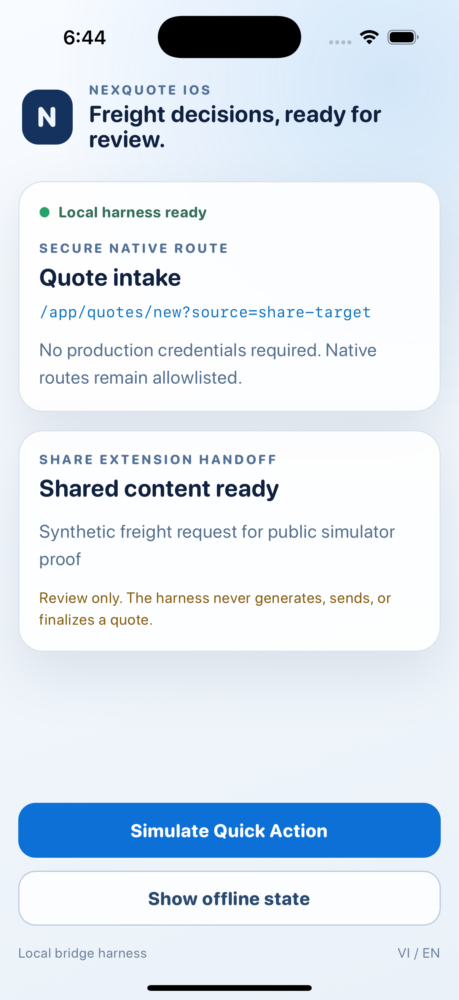
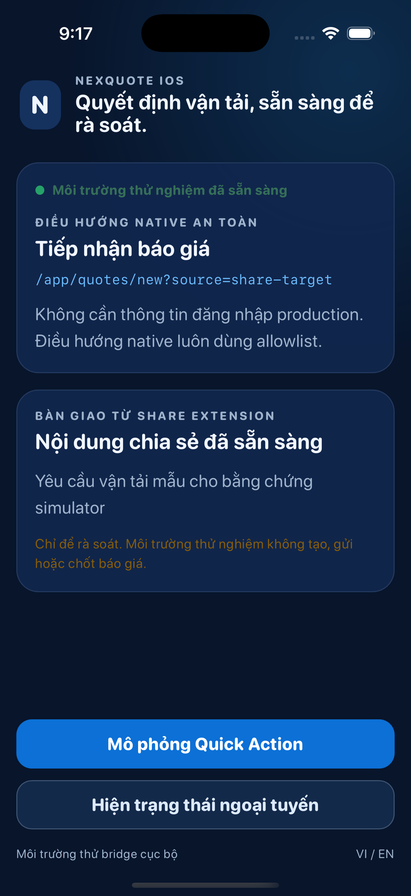
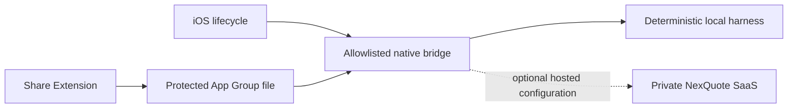

# NexQuote iOS

NexQuote iOS is the native client shell for freight-forwarding teams using the hosted NexQuote SaaS. It adds secure native entry points, an iOS Share Extension, Quick Actions, and a deterministic local harness without publishing the private pricing platform.

> Status: public engineering preview. The simulator harness is reproducible. TestFlight and App Store distribution are not available yet.

<p align="center">
  
  
</p>

## Native value

- Share text or a web URL into a protected, expiring quote-intake handoff.
- Open quote intake, rate import, or the decision inbox through allowlisted Quick Actions and deep links.
- Deliver native routes through a ready/acknowledge bridge with a bounded queue.
- Run the branded local harness without production credentials, customer data, or a backend.
- Build an optional hosted same-origin client through typed `.xcconfig` values.

## Architecture



The committed default is `harness`. Hosted mode accepts one HTTPS origin, `https://nexquoteapp.com`, so the private web client can keep relative `/api/v1` requests on the same origin. See [Architecture](docs/ARCHITECTURE.md) and [Bridge contract](docs/BRIDGE_CONTRACT.md).

## Requirements

- macOS with Xcode 16 or newer
- An installed iPhone simulator
- Python 3.10 or newer
- Network access for the pinned Capacitor Swift package on first resolution

No Apple Developer account, signing certificate, production login, or API credential is required for simulator validation.

## Build and test

Run the same complete gate used by CI:

```bash
./scripts/ci.sh
```

Run static publication gates on any platform with Python:

```bash
python3 scripts/validate_project.py
python3 scripts/repo_guard.py tree
python3 scripts/repo_guard.py docs
python3 scripts/repo_guard.py secrets --scope tree
```

The iOS gate resolves packages, validates plists and entitlements, runs unit and UI tests, builds Debug and Release simulator products, validates the embedded Share Extension, then launches and captures scrubbed proof on iPhone 16 Pro and iPhone SE (3rd generation) simulators under `artifacts/`. UI coverage includes English/Vietnamese labels, light/dark appearance, accessibility text size, offline/reconnect state, and accessible action names.

## Hosted configuration

`Config/Hosted.example.xcconfig` documents the only supported hosted origin. Copy it outside the repository, select it as the Release base configuration in a private signing workflow, then provision the App Group and Universal Links through the Apple Developer account.

The hosted SaaS, authentication system, Django API, full Vue application, pricing engine, infrastructure, OMEN/VANTIS implementations, and production configuration are intentionally absent. See [Public boundary](docs/PUBLIC_BOUNDARY.md).

## Security and privacy

- Route paths and query values are allowlisted; credentials and customer payloads are rejected from route URLs.
- Shared content is sanitized, limited to 65,536 encoded bytes, protected at rest, expires after 10 minutes, and is deleted after consumption.
- Shared content opens quote intake for human review. It never generates, sends, or finalizes a quote.
- The local harness blocks network connections through CSP and contains no authentication state.
- Runtime source does not log route or shared payload content.

Read [Security policy](SECURITY.md) and [Privacy model](docs/PRIVACY.md).

## Current limitations

- Hosted mode remains a SaaS web client inside a native shell and carries App Store Review Guideline 4.2 minimum-functionality risk.
- Universal Links require an associated-domain entitlement, an `apple-app-site-association` file, and Apple provisioning not included here.
- The Share Extension handoff is covered by simulator UI proof; final device acceptance still requires a provisioned build.
- iPhone portrait is the supported public configuration. iPad and landscape claims are intentionally removed until tested.

## License status

This repository is public for inspection and evaluation, not open source. No permission to copy, modify, redistribute, or create derivative works is granted. See [NOTICE](NOTICE). External contributions are not currently accepted.
